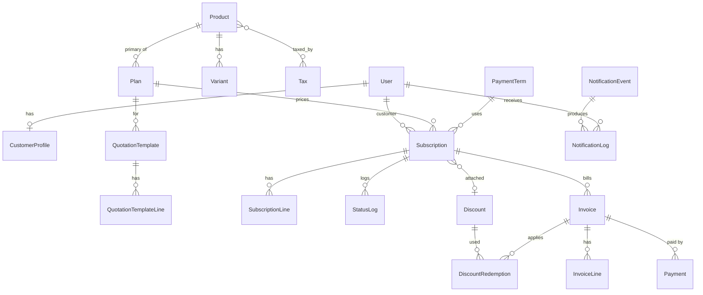

# Data model

Money = `DecimalField(max_digits=12, decimal_places=2)`. Timestamps are timezone-aware (Asia/Kolkata display, UTC storage).
`odoo_sync_status` ∈ `skipped | pending | synced | error` on every mirrored record.

## accounts
| Table | Fields | Constraints / indexes |
|---|---|---|
| **User** *(built in Phase 0)* | email, name, role (`admin/staff/customer`), is_active, created_at, password | unique(email); `UNIQUE Lower(email)` (`uniq_user_email_ci`) |
| **CustomerProfile** | user 1–1, company_name, phone, address, odoo_partner_id, odoo_sync_status, whatsapp_number (E.164), whatsapp_opt_in, whatsapp_opted_in_at, email_notifications | one per customer user |

## catalog
| Table | Fields | Constraints |
|---|---|---|
| **Product** | name, type (`service/software/addon/physical`), sales_price, cost_price, notes, is_active, odoo_product_id, odoo_sync_status; M2M taxes | idx(is_active) |
| **Variant** | product FK, attribute, value, extra_price | unique(product, attribute, value) |
| **Tax** | name, rate %, is_active, odoo_tax_id | rate 0–100 |
| **PaymentTerm** | name, days, is_default | exactly one default |
| **Plan** | name, product FK (primary), price, billing_period (`daily/weekly/monthly/yearly`), min_quantity, available_from/to, auto_close, allow_early_close, allow_pause, allow_renew, is_active | min_quantity ≥ 1; from ≤ to |

## subscriptions
| Table | Fields | Constraints / indexes |
|---|---|---|
| **QuotationTemplate** | name, plan, validity_days, is_active | |
| **QuotationTemplateLine** | template, product, variant null, quantity | |
| **Subscription** | number (`SUB-000001`), customer FK→User, plan, template null, status (`draft/quotation/confirmed/active/paused/closed`), start_date, expiry_date, payment_term, next_invoice_date, quotation_valid_until, discount null, notes, created_by, created_at | unique(number); idx(status), idx(customer), idx(status, next_invoice_date) |
| **SubscriptionLine** | subscription, product, variant null, description, quantity, unit_price, amount; M2M taxes | quantity ≥ plan.min_quantity |
| **StatusLog** | subscription, from_status, to_status, by_user, at | |
| **Counter** | name, value | numbering via `select_for_update` |

## billing
| Table | Fields | Constraints / indexes |
|---|---|---|
| **Invoice** | number (assigned at confirm), subscription, customer, status (`draft/confirmed/paid/cancelled`), invoice_date, due_date, period_start, period_end, subtotal, discount_total, tax_total, total, amount_paid, amount_due, odoo_move_id, odoo_sync_status, odoo_error, sent_at, created_at | **UNIQUE(subscription, period_start)**; unique(number) where not null; idx(status, due_date), idx(customer), idx(invoice_date) |
| **InvoiceLine** | invoice, kind (`product/discount`), product null, description, quantity, unit_price, tax_rate_snapshot, line_subtotal, line_tax, line_total | |
| **BillingRun** | started_at, finished_at, triggered_by, as_of_date, created_count, skipped_count, error_count, log | |

## discounts / payments / notifications
| Table | Fields | Constraints |
|---|---|---|
| **Discount** | name, code, type (`fixed/percent`), value, scope (`product/subscription`), M2M products, min_purchase_amount, min_quantity, start_date, end_date, usage_limit null, used_count, is_active, created_by | percent 0–100, fixed > 0, start ≤ end |
| **DiscountRedemption** | discount, invoice, amount | UNIQUE(discount, invoice) |
| **Payment** *(one row per attempt)* | invoice FK (PROTECT), amount, method (`cash/bank_transfer/upi/card/cheque/other`), payment_date, note, **status** (`completed/failed/reversed`), **attempt_number** (≥ 1), **retry_of** (nullable self-FK, SET_NULL), failure_reason, recorded_by, created_at, reversed_at, reversed_by, reversal_reason, odoo_payment_id, odoo_sync_status | amount > 0; attempt_number ≥ 1; **UNIQUE(retry_of)** where not null (a failed attempt is retried at most once); idx(invoice, status), idx(payment_date); only `completed` rows count toward `Invoice.amount_paid` |
| **PaymentEvent** *(append-only audit)* | invoice FK, payment FK (null), kind (`recorded/failed/retried/reversed/attention_flagged/attention_reset`), by_user, at, detail | idx(invoice, at); never updated or deleted |
| **Invoice** *(new fields, Phase 6)* | `failed_attempts` (failed attempts since the last completed payment or admin reset), `payment_needs_attention` (= `failed_attempts >= PAYMENT_MAX_ATTEMPTS`) | idx(payment_needs_attention) |
| **NotificationEvent** | code, label, enabled_email, enabled_whatsapp, template_body, meta_template_name | unique(code) |
| **NotificationLog** | event, channel, provider, recipient_user, recipient_address, object_type, object_id, body, status (`queued/sent/delivered/read/failed/skipped`), skip_reason, provider_message_id, error, attempts, next_attempt_at, dedupe_key, created_at, sent_at | **UNIQUE(dedupe_key)** |

