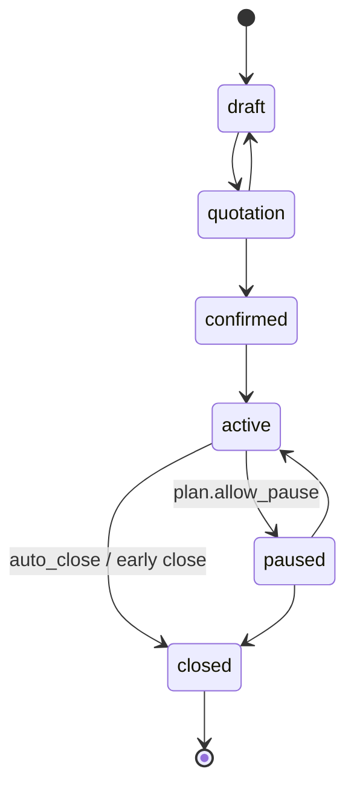
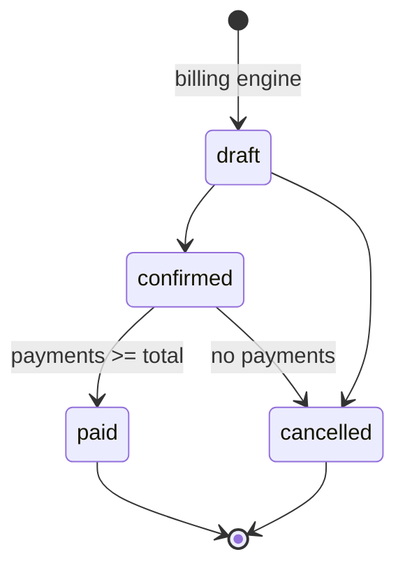

# State machines

Every change goes through one service (`subscriptions.services.transition`, `billing.services.*`); views never set `status` directly.
Each successful subscription transition writes a `StatusLog` row. Illegal transition → HTTP 409 `{"detail": "...", "code": "illegal_transition"}`.

## Subscription
| From → To | Who | Guards | Side effects |
|---|---|---|---|
| draft → quotation | staff, admin | ≥ 1 line; every line qty ≥ plan.min_quantity; plan available on start_date | set `quotation_valid_until = today + template.validity_days` (default 30); `QUOTATION_READY` notification |
| quotation → confirmed | staff, admin | quotation not expired | set `next_invoice_date = start_date` |
| quotation → draft | staff, admin | — | clears validity |
| confirmed → active | system (`activate_due`) / staff, admin button | `start_date <= today` | `SUBSCRIPTION_ACTIVATED` notification |
| active → paused | staff, admin | `plan.allow_pause` | billing skips it |
| paused → active | staff, admin | — | `next_invoice_date = max(existing, today)` (D-014, no back-billing) |
| active → closed | staff, admin | early close needs `plan.allow_early_close` (admin may override); engine auto-close (Phase 4) needs `plan.auto_close` and nothing left to bill | stops billing |
| *renew* (action, not a status) | staff, admin | status `active`, has `expiry_date`, `plan.allow_renew` | `expiry_date += (expiry − start)`; stays `active`; no status-log row (D-036) |
| draft / quotation / confirmed → closed | staff, admin | — (no plan flag needed before activation) | logged |
| active / paused → closed (override) | admin | admin may close regardless of `allow_early_close` | logged |

## Invoice
| From → To | Who | Guards | Side effects |
|---|---|---|---|
| (engine) → draft | system | UNIQUE(subscription, period_start) | Odoo draft after commit |
| draft → confirmed | staff, admin | has ≥ 1 product line | assign `number`; post to Odoo (`action_post`); `INVOICE_READY` notification |
| confirmed → paid | system | `amount_due == 0` after a payment | same transaction as the payment |
| draft → cancelled | staff, admin | — | slot (subscription, period_start) stays used (D-019) |
| confirmed → cancelled | admin | `amount_paid == 0` | Odoo `button_draft` → `button_cancel` (stretch) |
| paid → * | — | forbidden | — |

Overdue is **not** a status: `confirmed` ∧ `amount_due > 0` ∧ `due_date < today` (D-013).
