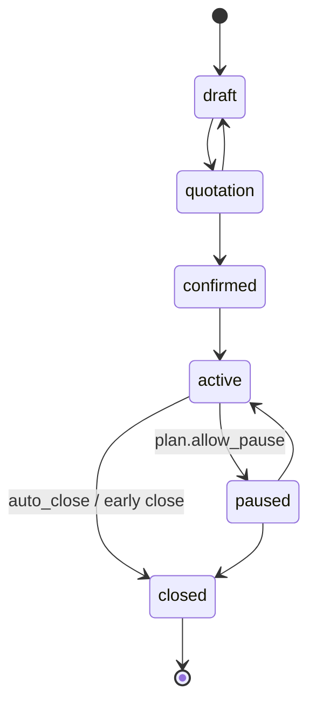
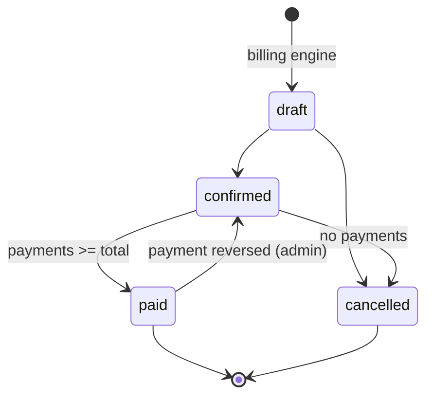
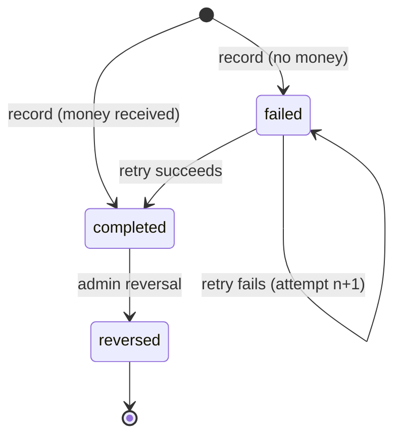

# State machines

Every change goes through one service (`subscriptions.services.transition`, `billing.services.*`); views never set `status` directly.
Each successful subscription transition writes a `StatusLog` row. Illegal transition → HTTP 409 `{"detail": "...", "code": "illegal_transition"}`.

## Subscription
| From → To | Who | Guards | Side effects |
|---|---|---|---|
| draft → quotation | staff, admin | ≥ 1 line; every line qty ≥ plan.min_quantity; plan available on start_date | set `quotation_valid_until = today + template.validity_days` (default 30); `QUOTATION_READY` notification |
| quotation → confirmed | staff, admin | quotation not expired | set `next_invoice_date = start_date` |
| quotation → draft | staff, admin | — | clears validity |
| confirmed → active | system (`activate_due`) / staff, admin button | `start_date <= today` | `SUBSCRIPTION_ACTIVATED` notification |
| active → paused | staff, admin | `plan.allow_pause` | billing skips it |
| paused → active | staff, admin | — | `next_invoice_date = max(existing, today)` (D-014, no back-billing) |
| active → closed | staff, admin | early close needs `plan.allow_early_close` (admin may override); engine auto-close (Phase 4) needs `plan.auto_close` and nothing left to bill | stops billing |
| *renew* (action, not a status) | staff, admin | status `active`, has `expiry_date`, `plan.allow_renew` | `expiry_date += (expiry − start)`; stays `active`; no status-log row (D-036) |
| draft / quotation / confirmed → closed | staff, admin | — (no plan flag needed before activation) | logged |
| active / paused → closed (override) | admin | admin may close regardless of `allow_early_close` | logged |

## Invoice
| From → To | Who | Guards | Side effects |
|---|---|---|---|
| (engine) → draft | system | UNIQUE(subscription, period_start) | Odoo draft after commit |
| draft → confirmed | staff, admin | has ≥ 1 product line | assign `number`; post to Odoo (`action_post`); `INVOICE_READY` notification |
| confirmed → paid | system | `amount_due == 0` after a **completed** payment (failed attempts never count) | same transaction as the payment, under the invoice row lock |
| draft → cancelled | staff, admin | — | slot (subscription, period_start) stays used (D-019) |
| confirmed → cancelled | admin | `amount_paid == 0` | Odoo `button_draft` → `button_cancel` (stretch) |
| paid → confirmed | admin, by **reversing a completed payment** | the reversal leaves `amount_due > 0` | balance restored; overdue again if the due date has passed |
| paid → cancelled / draft | — | forbidden | — |

Overdue is **not** a status: `confirmed` ∧ `amount_due > 0` ∧ `due_date < today` (D-013).

## Payment (one row per attempt; Phase 6, D-041)
`status`: `completed | failed | reversed`. Only `completed` counts toward `Invoice.amount_paid`. Every transition runs under the invoice row lock (lock order: invoice, then payment) and writes an append-only `PaymentEvent`.

| From → To | Who | Guards | Side effects |
|---|---|---|---|
| (new) → completed | staff, admin | invoice `confirmed`; `0 < amount ≤ amount_due`; `failed_attempts < PAYMENT_MAX_ATTEMPTS` | `amount_paid/amount_due` recomputed from the completed rows; invoice → `paid` if `amount_due == 0`; `failed_attempts := 0`, flag cleared; `PAYMENT_RECEIVED` after commit |
| (new) → failed | staff, admin | same guards; `failure_reason` required | **balance untouched**; `failed_attempts += 1`; at the limit → `payment_needs_attention := true` + `attention_flagged` event |
| failed → *retried* (a new row with `retry_of`) | staff, admin | the row is `failed`, has no retry yet (UNIQUE `retry_of`), limit not reached | new row gets `attempt_number = failed_attempts + 1`, then behaves as a new payment |
| completed → reversed | **admin** | reason required; invoice `confirmed` or `paid` | row kept with `reversed_at/by/reason`; balance recomputed; `paid → confirmed` if the balance is positive again; `failed_attempts` unchanged |
| failed / reversed → anything | — | forbidden (history is final) | — |
| attention flag → cleared | **admin** (`reset-payment-attempts`) | invoice `confirmed` and flagged / has failed attempts; reason required | `failed_attempts := 0`, flag cleared, `attention_reset` event; failed rows stay |

Attempt limit: `failed_attempts` counts failed attempts since the last completed payment or admin reset. When it reaches the limit (default 3) the invoice is flagged `payment_needs_attention` and every further attempt answers 409 `max_attempts_reached` until an admin resets it.
